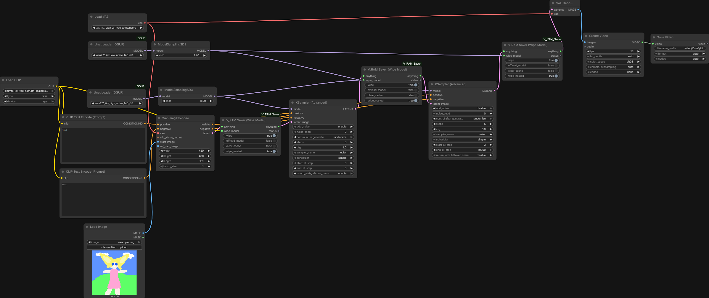
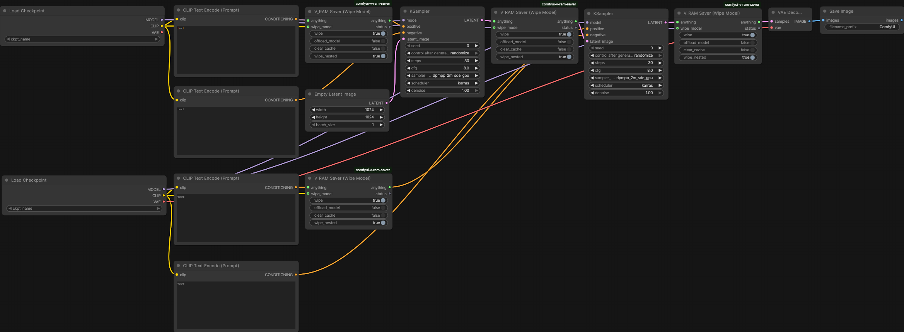

# ComfyUI-V_RAM_Saver

ComfyUI node that frees VRAM and RAM by wiping a single model mid-workflow (no CPU copy), or offloading it to CPU.

An inline passthrough node for [ComfyUI](https://github.com/comfyanonymous/ComfyUI) that frees one routed model (wipe or offload) and/or resets the node output cache, then returns its input unchanged.

Wan2.2 workflow

SDXL workflow


## Features

- **Wipe**: removes the routed model from VRAM and RAM without copying it to CPU.
- **Offload**: standard ComfyUI unload of the routed model only (copies to CPU).
- **Clear cache**: resets the node output cache after the prompt ends.
- Works with MODEL, CLIP and VAE inputs (including nested additional models).
- Colored console status output (set `NO_COLOR` to disable).

## Installation

### ComfyUI-Manager / Registry

Search for **ComfyUI-V_RAM_Saver** in ComfyUI-Manager and install.

### Manual

```bash
cd ComfyUI/custom_nodes
git clone https://github.com/Mirielz/ComfyUI-V_RAM_Saver.git
```

Restart ComfyUI. No extra dependencies are required.

## Usage

Add the node from **X-tools → V_RAM Saver (Wipe Model)**.

Connect `anything` to the output of the **last consumer** of the model you want to free, so the node runs only after the model is no longer needed.

### Inputs

| Name | Type | Description |
|------|------|-------------|
| `anything` | any (required) | Passed through unchanged. Wire from the last consumer of the routed model. |
| `wipe_model` | any (optional) | Model to free (MODEL, CLIP, VAE). |
| `wipe` | BOOLEAN | Remove the model from VRAM and RAM without CPU copy. Forces `clear_cache`. |
| `offload_model` | BOOLEAN | Normal ComfyUI unload to CPU. Ignored if `wipe` is active. |
| `clear_cache` | BOOLEAN | Reset the node output cache after the prompt ends. |
| `wipe_nested` | BOOLEAN | When wiping, also wipe nested additional models (ControlNet, etc.). Default: on. |

### Outputs

| Name | Type | Description |
|------|------|-------------|
| `anything` | any | The unchanged input. |
| `status` | STRING | Summary of the actions performed. |

## Notes

- A wiped model must be reloaded by its loader node on the next run; the cache reset ensures this.
- Tested with ComfyUI version: 0.45.3.

## Example workflow

See [`workflows/`](https://github.com/Mirielz/ComfyUI-V_RAM_Saver/tree/main/workflows).

## License

[MIT](LICENSE) © 2026 Mirielz